# bento

基于 DSH 与 OpenShell 的云端异步 Agent 平台，提供在线 Agent 工作空间。用户提交任务后，Agent 在云端隔离环境中后台执行，并交付结果。

主线源码提供单执行宿主的 Session 执行与接管入口。可信部署端提供 OpenShell 沙盒生命周期和观察，Bento 负责 Run 授权、会话持久化和接管。

## 架构



[整体架构与当前接线](docs/00-governance/ARCHITECTURE.md) · [需求完成状况](docs/40-readiness/CURRENT-READINESS.md)

## 当前代码入口

| 目录                                                                                                          | 当前职责                                                |
| ------------------------------------------------------------------------------------------------------------- | ------------------------------------------------------- |
| [`apps/workspace/workspace-auth`](apps/workspace/workspace-auth/package.json)                                 | 个人端独立构建的认证页面，由个人端 API 提供             |
| [`apps/workspace/workspace-web`](apps/workspace/workspace-web/README.md)                                      | 个人端 `/` 工作区，包含本地启动和浏览器验收命令         |
| [`apps/workspace/workspace-api`](apps/workspace/workspace-api/README.md)                                      | 个人端 Go HTTP API，提供认证、项目、Task 和文件空间     |
| [`apps/admin/admin-api/cmd/admin-api`](apps/admin/admin-api/cmd/admin-api/main.go)                            | 管理端 Go API                                           |
| [`apps/admin/admin-auth/src`](apps/admin/admin-auth/src/login.html)                                           | 管理端登录页面                                          |
| [`apps/admin/admin-web/src`](apps/admin/admin-web/src/index.html)                                             | 管理端 Workspace 诊断页面                               |
| [`apps/orchestrator/orchestrator-control`](apps/orchestrator/orchestrator-control/cmd/control/main.go)        | Go Temporal 编排、Run 与授权账本                        |
| [`apps/worker`](apps/worker/src/run-worker.ts)                                                                | DSH Worker 进程入口                                     |
| [`apps/orchestrator/orchestrator-execution-host`](apps/orchestrator/orchestrator-execution-host/src/index.ts) | TypeScript 执行 HTTP 服务、Worker 管理和 OpenShell 适配 |

[部署手册](deploy/README.md)说明如何通过[统一 Compose](deploy/compose.yaml)启动 Bento，以及如何接入 OpenShell 和 Temporal。启动 Orchestrator 前需按手册生成和配置执行环境版本。

## 设计与验证

- [需求](docs/10-requirements/README.md) · [验证与交付](docs/40-readiness/CURRENT-READINESS.md)

## 开发

[AGENTS.md](AGENTS.md) 是仓库协作入口。[工程治理规则](docs/00-governance/DOCUMENT-RULES.md)约定文档、实现、测试、提交与 PR 的做法。

Node.js 22.19+ 的 22.x 或 24+，pnpm 12.15.0，Go 1.25.3+。

TypeScript 使用 `@/` 引用仓库根目录下的源码，导入保留显式 `.ts` 路径。TypeScript、Node、Vite 与 Lint 使用根目录 `tsconfig.json` 的别名定义。直接用 Node 启动仓库的 TypeScript 入口时，从仓库根目录传入 `--import ./register-paths.mjs`。

```sh
pnpm install
pnpm check
pnpm format
```

认证前端可独立执行 `pnpm --filter @bento/workspace-auth build`。

仓库级静态检查使用 `pnpm lint` 和 `pnpm format:check`。`pnpm format` 用 Prettier 写入其支持的文件。Go 使用 `gofmt`，可单独运行 `pnpm format:go:check`。TypeScript 等 Prettier 管理的源码使用 4 个空格缩进，Go 使用 Tab，在编辑器中按 4 列显示。

| 命令                      | 验证范围                                                         |
| ------------------------- | ---------------------------------------------------------------- |
| `pnpm check:workspace`    | 个人端认证构建、Go API、模拟 API 测试及 Web 类型检查、测试和构建 |
| `pnpm check:admin`        | 管理端 Go 测试和 `go vet`                                        |
| `pnpm check:orchestrator` | Go 编排、TypeScript 执行宿主和 Worker 复用、Temporal 重投验收    |
| `pnpm check:worker`       | 独立 Worker 类型检查                                             |

Go 模块将可执行入口放在 `cmd/`，私有包放在 `internal/`。Orchestrator 的 Go 构建入口为 `go -C apps/orchestrator/orchestrator-control build ./cmd/control`。执行宿主的 [Run 恢复](apps/orchestrator/orchestrator-execution-host/src/execution-service/run-recovery.ts)和 [Run 持久化](apps/orchestrator/orchestrator-execution-host/src/execution-service/store/runs.ts)位于 `src/execution-service/`。其 TypeScript 模块测试可用 `pnpm --filter @bento/orchestrator test` 运行。

CI 每次运行仓库级 Lint 和格式检查，再按完整变更范围选择应用检查与专项验收。Web 常规回归、空间完整性和队列隔离分别触发。Orchestrator 或 Worker 的运行代码变更也会触发依赖真实执行宿主的队列验收。公共配置和未知路径触发全量检查。当前任务与命令见 [CI 配置](.github/workflows/checks.yml)，聚合门禁和合并要求见 [PR 规则](docs/00-governance/PR-RULES.md)。

Worker正式运行时可选用[base-bootstrap.ts](apps/worker/src/runtime/base-bootstrap.ts)，每轮新建官方DSH与SDK资源，清理后才返回回执。可信配置、模型factory及Task投影边界见[Worker运行时部署](deploy/README.md#worker-正式运行时与复用验证)。

`pnpm --filter @bento/orchestrator test:worker-runtime`运行bootstrap/transport单测，`test:worker-reuse`运行SDK准备、生产ingress和64轮常驻Worker验收（默认长时模式最少315秒）；两者均纳入本地 `check:core`。PR CI 使用 `BENTO_A6_WORKER_REUSE_MODE=burst` 连续执行相同64轮及隔离断言，不主动补足轮间5秒间隔；main CI和本地默认 `soak` 保留至少315秒跨度。连续模式不代表长时间驻留验证通过。GitHub CI 对仅涉及执行服务测试目录和两个 Go Temporal 测试文件的变更运行常规检查。Orchestrator 或 Worker 的运行代码、部署、验收及未知范围变更仍触发常驻 Worker 验收。SDK默认按固定官方来源真实构建，本地受控输入范围见部署手册。

管理端诊断入口的配置与启动见[部署手册](deploy/README.md#管理端诊断入口)。
