# bento

基于 DSH 与 OpenShell 的云端异步 Agent 平台，提供在线 Agent 工作空间。用户提交任务后，Agent 在云端隔离环境中后台执行，并交付结果。

主线源码提供单执行宿主的 Session 执行与接管入口。可信部署端提供 OpenShell 沙盒生命周期和观察，Bento 负责 Run 授权、会话持久化和接管。

## 架构



[整体架构与当前接线](docs/00-governance/ARCHITECTURE.md) · [需求完成状况](docs/40-readiness/CURRENT-READINESS.md)

## 当前代码入口

| 目录                                                                                    | 当前职责                                                               |
| --------------------------------------------------------------------------------------- | ---------------------------------------------------------------------- |
| [`apps/workspace/auth`](apps/workspace/auth/package.json)                               | 个人端独立构建的认证页面，由个人端 API 提供                            |
| [`apps/workspace/web`](apps/workspace/web/README.md)                                    | 个人端 `/` 工作区，包含本地启动和浏览器验收命令                        |
| [`apps/workspace/api`](apps/workspace/api/README.md)                                    | 个人端 HTTP API，Go 提供入口和 MySQL 账号仓储，TypeScript 处理业务请求 |
| [`apps/orchestrator`](apps/orchestrator/go.mod)                                         | Go Temporal 编排模块                                                   |
| [`apps/worker`](apps/worker/run-worker.ts)                                              | DSH Worker 进程入口                                                    |
| [`apps/orchestrator/execution-service`](apps/orchestrator/execution-service/service.ts) | 当前的执行 HTTP 服务和 Run 权威账本                                    |

[部署手册](deploy/README.md)说明如何通过[统一 Compose](deploy/compose.yaml)启动 Bento，以及如何接入 OpenShell 和 Temporal。

## 设计与验证

- [需求](docs/10-requirements/README.md) · [验证与交付](docs/40-readiness/CURRENT-READINESS.md)

## 开发

[AGENTS.md](AGENTS.md) 是仓库协作入口。[工程治理规则](docs/00-governance/DOCUMENT-RULES.md)约定文档、实现、测试、提交与 PR 的做法。

Node.js 22.19+ 的 22.x 或 24+，pnpm 12.15.0，Go 1.25.3+。

TypeScript 使用 `@/` 引用仓库根目录下的源码，导入保留显式 `.ts` 路径。直接用 Node 启动仓库的 TypeScript 入口时，从仓库根目录传入 `--import ./register-paths.mjs`。

```sh
pnpm install
pnpm check
pnpm format
```

认证前端可独立执行 `pnpm --filter @bento/workspace-auth build`。

可按工程运行 `pnpm check:workspace`（个人端认证、API 和 Web）、`pnpm check:orchestrator`（Run 编排与执行宿主）或 `pnpm check:worker`（独立 Worker）。

使用 ESLint 与 Prettier，统一 4 空格缩进。
