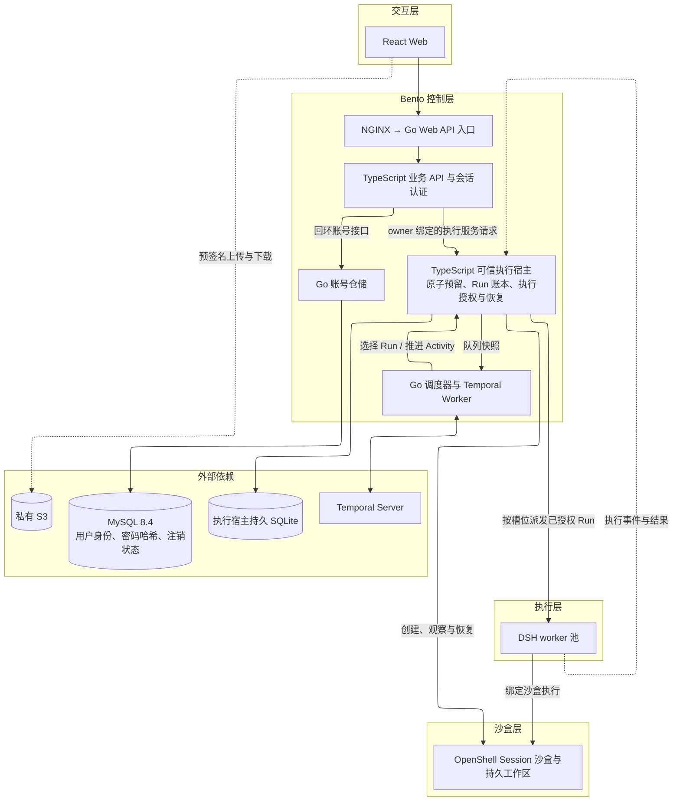

# Bento 整体架构

本文说明 Bento 的系统组成、职责、数据所有权和依赖方向。实现覆盖见[验证与交付](../40-readiness/CURRENT-READINESS.md)。

## 架构决策

- 一个顶层业务 Session 对应一个沙盒，跨多个 Run 存续；内部子 Agent Session 不自动创建独立业务沙盒。
- worker 为共享执行池，领取 Run 后动态绑定 Session、执行授权与沙盒。用户注册不固定占用一个 DSH 进程；同进程多 Session 的可行性已验证，生产并发和池化复用仍须验收。
- Workspace 持有持久 Volume，多个 Session 可以共享该 Volume。沙盒是执行生命周期，Volume 是数据生命周期；删除沙盒不得默认删除项目卷。
- 同 Session 默认一个活跃写 Run；共享 Workspace 不默认全局独占。共同编辑必须定义版本守卫、冲突和锁策略。
- 可信 DSH harness 在沙盒外，用户代码在沙盒内。业务服务端决定 tenant/workspace/session/run/generation/sandbox/volume 绑定，worker 和模型不能任意选择目标。
- 运行时挂载和服务身份由受信控制面配置。用户沙盒不挂载宿主 Docker socket、宿主公共父目录或平台管理凭据。
- Session 日志所有权与沙盒执行权分别撤销，只有 generation/owner 一致、旧执行完成停止/对账、绑定及挂载确认后才能 READY。UNKNOWN 先观察/对账，不能因未收到结果就重放副作用。

## 应用与编排的目标职责

目标边界对应[应用与编排边界需求](../10-requirements/APPLICATION-BOUNDARIES-REQUIREMENTS.md)，实现机制见[应用与编排边界设计](../30-designs/APPLICATION-BOUNDARIES-DESIGN.md)。

- 个人端和管理端各有独立的认证前端、业务前端和 API，分别使用独立的 Keycloak Realm。各端 API 管理业务会话和授权，以内部服务身份调用 Orchestrator。个人端 API 由单个 Go 进程提供 HTTP、认证会话和业务接口，并直接访问 MySQL。
- 单一 Go Orchestrator 持有 Run 权威账本，负责 Temporal 编排、槽位、Worker 生命周期、执行授权和故障恢复。Temporal 保存编排历史，Orchestrator 管理业务状态。
- DSH Worker 独立运行，使用当次授权调用 OpenShell 执行接口。受信停启观察、管理凭据和账本写入由 Orchestrator 管理。

## 当前实现接线

[统一 Compose](../../deploy/compose.yaml)部署个人端、MySQL、Keycloak、PostgreSQL 和 Orchestrator。开发用 Temporal 与 Mailpit 在同一文件启用。执行服务调用受信 OpenShell 适配器，外部沙盒、模型与对象存储由部署环境提供。

个人端 API 读取独立构建的认证页面和样式。管理端和 Go Orchestrator 接管执行账本及受信执行路径仍待实现。当前 TypeScript 执行服务位于 `apps/orchestrator/execution-service/`，受信 OpenShell 控制面位于 `apps/orchestrator/openshell/`。

- Run 编排已接入 Temporal [单执行宿主模式](../../deploy/README.md#temporal-配置)。Temporal 持有调度历史，Bento 在 SQLite 持久化 Run 状态、Session、Workspace 绑定和执行授权。Activity 重投以持久 Run 状态决定派发或恢复。账号身份、密码哈希与注销清理状态使用 MySQL；执行宿主的 Run、Session、Workspace 和授权账本继续使用持久 SQLite。
- [Web 部署](../../deploy/README.md#启动与检查)由 NGINX 同域提供静态前端并代理 Go Web API 入口。Go 提供 MySQL 账号仓储，现有 TypeScript task-entry 处理业务 API 与会话认证；浏览器直传 S3。
- 启用 Temporal 时，Go 控制面负责租户公平派发策略与 Temporal Client/Worker。TypeScript 执行宿主通过私有标准输入输出协议提供队列快照、原子预留和推进 Run 的能力，继续持有 generation fencing、OpenShell 绑定和恢复账本。Go 选出的 Run 必须经过宿主的容量和状态条件写入后才能发布 Workflow。

### 当前分层

下图描述当前接线。控制层分为 Web 入口部署与执行宿主部署，个人端 Go API 入口与 Orchestrator 的 Temporal 模块各自构建。当前 TS 执行服务持有 Run 账本和执行授权。

## 外部依赖与数据归属

- Keycloak 持有身份、凭据与认证审计。个人端持有业务账号映射、会话、项目授权和注销状态。
- 私有 S3 保存个人端原始文件。文件归属、上传状态和额度由个人端 API 管理。OpenShell Volume 保存执行工作区，Orchestrator 管理绑定和回收。
- Temporal 保存编排历史。Run 权威账本持有执行尝试、授权和恢复状态。Worker 按当次授权执行，由受信控制面观察停止与回收。

Web 的认证、存储与任务交互见[Web 系统设计](../30-designs/WEB-DESIGN.md)。
