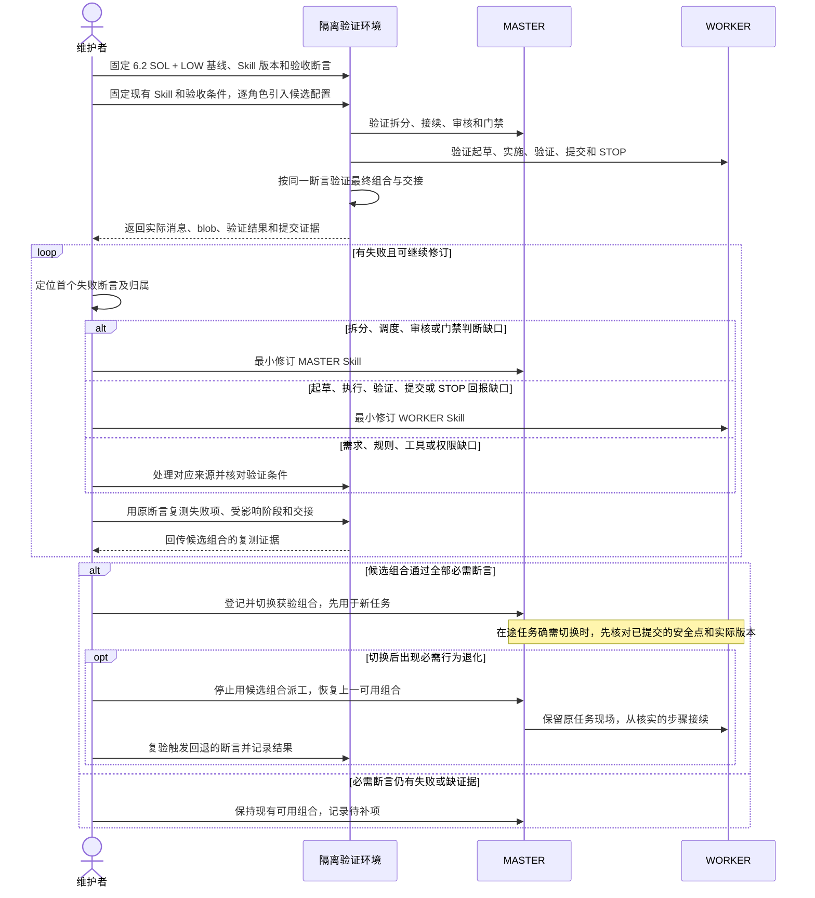

# Bento 维护者手册：需求编写与 MASTER／WORKER 协作

本手册面向负责配置和维护 Bento AI 自动化的人。目标是在已确认的需求和授权范围内，由 AI 自动完成任务拆分、代码编写、验证与提交。维护者负责确认产品行为和授权范围，并处理自动化无法确定的冲突或阻断。

协作流程的测试模型为 **6.2 SOL + LOW**。调整模型或推理强度时，按本手册的升级流程重新验证。

## 配置项与维护位置

| 配置项                                                             | 维护内容                                                                                                      |
| ------------------------------------------------------------------ | ------------------------------------------------------------------------------------------------------------- |
| [需求文档](../10-requirements/README.md)                           | 定义产品行为、场景编号与验收标准，供 MASTER 拆分任务和核对交付。                                              |
| [Readiness](../40-readiness/CURRENT-READINESS.md)                  | 按同一场景编号记录实现状态、通过证据和剩余验收。MASTER 据此识别待派工的缺口，并在交付时核对证据是否覆盖需求。 |
| [RUNBOOK Rules](../00-governance/RUNBOOK-RULES.md)                 | 规定何时使用 RUNBOOK，以及怎样把已确认的决定写成可执行、可验证的步骤。                                        |
| [MASTER Skill](../../.agents/skills/bento-runbook-master/SKILL.md) | 配置选题、任务拆分、WORKER 绑定、计划审核、交接和交付监督。                                                   |
| [WORKER Skill](../../.agents/skills/bento-runbook-worker/SKILL.md) | 配置计划起草与返修的交接，以及获准开工后的实现、验证、提交与恢复。                                            |

## 规格驱动开发（Spec-Driven Development）

先确认需求规格，再由 MASTER 据此拆分任务，由 WORKER 把已确认的行为和验收标准编入 RUNBOOK。实现、测试和 Readiness 沿用同一套场景编号。

1. **严格标明 Happy Path 和 Bad Case。** 每个场景标题标出类型和稳定编号。Happy Path 写清调用方、触发条件、正常入口和可观察结果。每个可独立验收的 Bad Case 单独成节，写明触发条件、应保护的状态或数据，以及可观察的拒绝或恢复结果。
2. **写可观察的验收断言。** 写明从哪里触发、到哪里取证、什么结果算通过。维护者应能沿场景编号核对需求、代码入口和测试证据。
3. **让交付边界可判断。** 写明依赖的接口、状态所有者和前置条件。MASTER 据此识别可独立交付的需求；共享接口、数据或测试环境需要明确的执行与合入顺序。未决的产品行为在确认后再纳入正式需求。
4. **拆到 LLM 能独立理解的单元。** 每个场景聚焦一种可独立验证的行为。维护者应能从该场景及其引用看清触发条件、行为边界和通过标准。如果还需要 LLM 自行决定产品行为、接口语义或通过条件，就继续拆分或补齐规格。共用入口或环境的场景可以合在同一交付任务中，各自保留验收断言。

设计补充模块职责、权威状态和恢复方式，接口契约固定跨边界的字段、权限和错误语义。维护者在派工前核对这些依据是否足以让作者固定 RUNBOOK 的实现与验收步骤。 [需求文档](../10-requirements/README.md) · [文档规则](../00-governance/DOCUMENT-RULES.md#required-structures)

## 启动自动化

维护者启动 MASTER 时，说明要推进的范围、是否只到审核，以及允许的交付动作。

1. **先找 WORKER 并确认状态。** 按 Codex 项目和独立 clone 核对未归档 WORKER 聊天、最后通过的步骤和 PR。逐个汇报项目空闲、在途或待核实。没有未归档 WORKER 聊天的项目记为空闲，派工前另行核对 checkout、任务和验收环境。Bento 任务目录使用独立 clone。
2. **通知仍需接续的 WORKER 当前 MASTER 的会话 ID。** 已确认结项且无待办的会话跳过。其余会话按状态处理，包括正在执行、已暂停和聊天空闲但仍有待办的 WORKER。请 WORKER 在通知授权范围内向该会话回报问题、阻断或待决事项。正在执行的继续原任务，暂停的等待单独的恢复指令。
3. **按状态恢复或派工。** 暂停的先审核任务状态、最后安全点和恢复条件，满足条件后从原 WORKER 聊天重新启动。用户主动暂停的任务等恢复授权。聊天空闲但任务未完的回原聊天接续。确认原任务已收尾或明确移交，且 checkout 干净并已同步目标分支后，按正式需求和 Readiness 拆分新任务，创建 WORKER 聊天并派发起草。新派工也附当前 MASTER 的会话 ID。

[MASTER Skill](../../.agents/skills/bento-runbook-master/SKILL.md) · [WORKER Skill](../../.agents/skills/bento-runbook-worker/SKILL.md)

### 从需求编号和 Readiness 选题

1. **按编号定位剩余工作。** 从最新目标分支读取正式需求与 Readiness。先按一级需求找到所属场景，再逐个核对场景的验收断言、现有证据及其基线。区分正常入口缺实现、必需用例缺通过记录和证据需要复验。已有证据仍适用于本次基线和环境时可以复用。
2. **划定最小交付范围。** 为每个候选写清本次要使哪些正式需求项达到「已实现」，逐项列出编号、剩余实现、必需用例和通过证据。将必须一起变更或验收的需求纳入同一任务，说明合并理由，各场景仍按编号对账。单独只能完成中间产物的工作，放进对应任务作为步骤。派工前按 RUNBOOK Rules 初估整项范围，至少 500 LOC、5 个不同代码文件。只计直接相关的生产代码、测试和可执行脚本，逐文件记录符号或行范围并去重。送审及范围变化时复核。
3. **验证能否独立验收。** 在可核对的代码基线上确认正式需求或接口依据、实际入口、测试环境、取证位置和通过条件。候选任务完成后，应能用当前基线已有能力及本任务产物跑完必需用例，独立判断结果和受保护状态。若必需接口尚待另一任务交付，登记前置任务，待其合入后重新核对基线和验收。缺少正式依据、可用环境或可判断的证据时，记录缺口并评估其他候选。

### 判断哪些任务能并行

每个 WORKER 按独立开发者配置，在自己的 checkout 和独立测试环境中开发与验证。使用 Docker 时，为每个 WORKER 创建自己的一套测试容器及配套网络、卷和测试数据。需要映射宿主机端口时，各环境使用互不冲突的端口。MASTER 派工前确认环境可分配并提供受控入口。各 WORKER 在自己的环境做预检或 T0，核对实际资源并向 MASTER 回报证据。查询失败、资源缺失或归属不明时，WORKER 停在环境门槛，报告预期、脱敏实际结果和恢复条件，由 MASTER 决定补查或暂缓。

逐对比较候选与在途任务的生产入口、关键文件、接口契约和权威状态。两项任务有各自的测试环境后，仍须核对代码依赖和合入顺序。

| 核对结果                                                     | 派工方式                                                                     |
| ------------------------------------------------------------ | ---------------------------------------------------------------------------- |
| 实现与验收互不依赖，关键边界和测试资源可隔离                 | 可并行派工，各自验收。                                                       |
| 实现可独立推进，但涉及同一接口或权威状态                     | 先明确修改归属、合入顺序和后合入方需复验的行为；约定能消除冲突时才并行推进。 |
| 必须依赖另一任务的变更才能完成实施或验收，或共享风险无法消解 | 记录前置任务和复验项，按依赖顺序推进。                                       |

通过上述核对后，派工消息列出需求编号、基线、范围、验收断言和并行约定。[需求文档](../10-requirements/README.md) · [Readiness](../40-readiness/CURRENT-READINESS.md) · [RUNBOOK Rules](../00-governance/RUNBOOK-RULES.md)

### MASTER 流程时序图

```mermaid
sequenceDiagram
    actor H as 维护者
    participant M as MASTER
    participant D as 需求文档与 Readiness
    participant W as WORKER
    participant R as 审核 SUBAGENT
    participant G as Git 与 GitHub

    H->>M: 启动并指定任务范围、阶段与授权
    M->>W: 查找已有 WORKER 聊天并回读任务状态
    M->>G: 核对 checkout、工作区、最后通过的步骤与在途 PR
    M->>M: 排除已确认结项且无待办的旧会话
    M->>W: 按通知授权向其余 WORKER 提供当前 MASTER 会话 ID
    Note over M,W: 遇到问题、阻断或需要决定时向该会话回报
    alt 正在执行
        M->>W: 在原聊天继续监督
    else 已暂停
        M->>W: 审核暂停状态、最后安全点和恢复条件
        opt 条件已满足且允许恢复
            M->>W: 在原聊天从安全点重新启动
        end
    else 聊天空闲但原任务仍有待办
        M->>W: 在原聊天接续审核、执行或收尾
    else checkout 空闲、干净且已同步
        M->>D: 从最新目标分支按编号核对需求、验收和已有证据
        D-->>M: 返回场景状态、剩余实现与验收缺口
        M->>M: 划定最小交付范围，确认本次达到已实现的需求项
        alt 正式依据、基线、环境、独立验收及 RUNBOOK 规模门槛齐备
            M->>G: 确认可分配的独立测试环境及任务间的代码和接口依赖
            alt 相互独立或共享边界已有执行与合入约定
                M->>W: 向空闲 WORKER 派发任务、独立测试环境、验收与 MASTER 会话 ID
            else 存在前置依赖或冲突无法消解
                M->>M: 记录前置任务、合入顺序和后续复验
            end
        else 必要条件缺失
            M->>M: 记录缺口，暂缓该候选并评估其他需求
        end
    else 无可用 checkout
        M->>M: 记录阻断，保留任务和工作区归属
    end

    opt 当前阶段为 RUNBOOK 起草或审核
        W->>W: 核对派工范围和基线，起草 T0 与可执行步骤
        W->>M: 向绑定会话送审，附任务、checkout、基线、路径、blob 和逐文件范围
        M->>M: 核对送审版本，在当前回合派生只读审核 SUBAGENT
        loop 初审及每次返修后的复审
            M->>R: 发待审版本、正式依据和验收断言
            R->>R: 回读实际 blob，核对验收、文件边界及有无过度设计
            R-->>M: 按实际 blob 回报结论、证据和最小修订
            M->>W: 向原 WORKER 转发 Executable、Not Executable 或 Blocked
            W-->>M: 按 blob 确认收到和处理
            opt MASTER 指定返修或补查
                W->>W: 在原 checkout 按指定范围修订
                W->>M: 回报新 blob 和改动范围，供原审核者复审
            end
        end
        Note over M,W: 缺口仍在时保留任务归属，以 Blocked 结束本轮
    end

    opt 实际草稿和基线与 Executable 结论一致，且获准提交计划
        M->>W: 在任务分支单独提交获审 RUNBOOK
        W->>G: 提交获审版本
        M->>G: 核对提交仅含获审文件且 blob 一致
        M->>M: 核对分支、基线、工作区、T0 证据和实施授权
    end
    opt 对应 WORKER 环境预检或 T0
        W->>W: 在自己的环境核对实际资源归属与隔离
        W-->>M: 回报通过证据或环境错误与恢复条件
        M->>M: 核对证据，错误或缺项时暂缓实施
    end
    opt 获审提交已核对、T0 通过且本轮授权实施
        M->>W: 显式调用 WORKER Skill，附计划文件、分支、审核提交和基线
        W-->>M: 核对绑定 checkout、获审提交和 T0 后确认开工
        loop 按 RUNBOOK 步骤执行
            W->>W: 核对前置条件和文件范围，实施当前步骤并运行规定验证
            alt 命令、测试覆盖和规定断言均通过
                W->>W: 记录 PASS，删本步说明，最后一步更新 Readiness 并删 RUNBOOK
                W->>G: 单独提交本步产物和 RUNBOOK 变化，回读提交
                Note over W,G: 提交失败留在本步，证据受影响时重验
            else STOP
                W-->>M: 保留现场，回报失败步骤、最后通过步骤和提交、复现与脱敏结果
                M->>G: 核对最后通过的提交和当前工作区
                alt 原计划内可恢复
                    M->>W: 明确恢复条件，从原步骤重验
                else 需要修改计划、范围或正式依据
                    M->>W: 将受影响步骤交回原 WORKER 返修
                    W->>M: 回报新版 RUNBOOK blob 和改动范围
                    M->>R: 按新 blob 复审修订及受影响步骤
                    R-->>M: 回报新版审核结论
                    M->>W: 转发结论
                    opt 新版通过审核及适用的开工条件
                        M->>W: 从核实的步骤恢复
                    end
                else 仍待决定或缺少证据
                    M->>W: 保留任务归属和 STOP，记录恢复条件
                end
            end
        end
        opt 本地收口完成且授权 PR 交付
            W->>G: 核对收口提交和差异，推送并创建或更新同一 PR
            W->>G: 核对规定验证和已触发的必需 CI，按授权转 Ready
            W-->>M: 回报 PR、base、HEAD、Readiness 条目和验收证据
            loop 按当前 PR HEAD 核对
                M->>D: 逐场景核对需求、Readiness 与证据覆盖
                M->>G: 核对远端门禁、CI、Codex 结论、审批及 Review 对话
                opt 证据缺口、失败或可执行反馈
                    M->>W: 交原 WORKER 补验或返修
                    W-->>M: 回报补验结果或新 HEAD
                end
            end
            opt 外部检查明确受阻或到达约定观察期限
                M->>M: 保留原 PR 与任务归属，记录当前 HEAD 和恢复条件
            end
            opt 当前 HEAD 满足全部门禁且获授权合并
                W->>G: 按已核对的 HEAD 执行普通 merge commit
                W->>G: 回读合并提交并确认已进入目标分支
                W->>G: 快进 checkout，按授权清理已合入的任务分支
                W-->>M: 回报合并 SHA、同步基线和清理结果
                M->>G: 核对收尾，同步 MASTER 与空闲 checkout
                M->>W: 在途任务到安全点同步，按约定复验共享边界
                M->>D: 按最新主线和 Readiness 重新评估待派工缺口
                opt 有可独立交付的候选和空闲 checkout
                    M->>W: 创建新的 WORKER 聊天并派工
                end
            end
        end
    end

    M-->>H: 汇报交付、阻断和待决事项
```

## MASTER／WORKER 任务必须建立 RUNBOOK

MASTER／WORKER 的实施任务均须建立临时 RUNBOOK，并在获审后开工。MASTER 按 RUNBOOK Rules 的适用条件选题，简单局部改动采用直接交付流程。 [RUNBOOK 规则](../00-governance/RUNBOOK-RULES.md)

## 分工与审核

| 角色          | 负责的判断与交付                                                                              |
| ------------- | --------------------------------------------------------------------------------------------- |
| 维护者        | 确认产品行为、处理正式依据冲突，决定任务授权和恢复条件。                                      |
| MASTER        | 选题、绑定 WORKER、审核范围与验收证据，核对各 WORKER 回报的环境证据、转发审核结论并跟踪交付。 |
| WORKER        | 调查基线、起草和修订 RUNBOOK。获准开工后在自己的环境中开发、验证、记录证据并按授权交付。      |
| 审核 SUBAGENT | 只读核对实际草稿版本，给出结论、依据和最小修订范围，并检查是否存在过度设计。                  |

### 起草与送审

原 WORKER 在绑定的 checkout 核对派工范围、正式需求及接口依据、代码基线和验收条件，调查实际入口与文件。在 `docs/30-designs/` 起草临时 RUNBOOK，写明范围、非目标和正式依据，单列 T0，每一步写清独立产物、文件边界、可执行验证命令、PASS、STOP 和提交边界。每步最多涉及 10 个文件，计入 RUNBOOK 和专门核对的文件。作者预先解决产品、接口和恢复决策，将完整验证集合及收口条件固定在计划中。送审前逐步走读，检查路径、符号、命令、文档链接和 diff。

送审时，WORKER 主动向绑定的 MASTER 会话报告任务标识、checkout、基线、RUNBOOK 路径、实际草稿 blob hash 和逐文件代码范围。跨聊天无法送达时，将同样的回报留在原 WORKER 聊天供 MASTER 回读。 [RUNBOOK Rules](../00-governance/RUNBOOK-RULES.md) · [WORKER Skill](../../.agents/skills/bento-runbook-worker/SKILL.md)

### 审核、转发与复审

审核与修改均禁止过度设计。审核意见应指出具体缺口、受影响的需求或验收断言，并给出解决缺口的最小修订范围。WORKER 优先复用现有实现，返修限于满足已确认需求、接口契约和必需验收的改动。与当前缺口无关的抽象、扩展点和重构留待单独评估。

MASTER 核对送审版本，在当前回合派生只读审核 SUBAGENT，提供正式依据、代码基线、草稿路径与 blob、在途任务边界和验收断言。审核者回读实际文件，检查是否可以按步骤直接执行和判断通过，并按实际 blob 回报结论、证据、影响和最小修订。

默认由 MASTER 将三种结论都转发给原 WORKER，附对应 blob、返修范围或恢复条件。发送成功、收到消息、按该版本处理分别确认，接收方的返修回报或结论确认可作为处理证据。 [MASTER Skill](../../.agents/skills/bento-runbook-master/SKILL.md)

- **Executable**。当前版本已写清执行决定和验证边界。核对获审版本、基线、前置条件和开工授权后推进。
- **Not Executable**。草稿仍有可修订的缺口。由原 WORKER 返修，复审对应的新版本。
- **Blocked**。记录缺少的决定、环境或证据及恢复条件，保留原任务归属。能独立完成的文档修订可先处理。

返修由原 WORKER 在原 checkout 按指定范围完成，回报新 blob 和改动范围。MASTER 将新版交给原审核 SUBAGENT，复核实际 blob、修订项和直接受影响的步骤，再将新版结论发回原 WORKER。

### 开工条件

1. **获审版本可核对。** MASTER 确认 `Executable` 对应实际草稿 blob 和当前基线。在授权范围内安排原 WORKER 开任务分支，单独提交获审 RUNBOOK。MASTER 回读提交，核对只包含该文件且 blob 与获审版本一致。
2. **T0 通过。** 确认任务分支、基线、工作区和执行环境均符合 T0。草稿内容或基线发生影响执行的变化时，先复审受影响步骤。
3. **本轮授权实施并收到开工指令。** MASTER 在原 WORKER 聊天显式调用 `$bento-runbook-worker <RUNBOOK 文件名>`，附任务分支、审核提交、基线、授权和合入顺序。WORKER 核对绑定 checkout、获审提交和 T0 证据后开工。仅限起草或审核的任务在约定阶段收口。 [MASTER Skill](../../.agents/skills/bento-runbook-master/SKILL.md) · [WORKER Skill](../../.agents/skills/bento-runbook-worker/SKILL.md)

## 逐步实施、验证和提交

1. **执行当前步骤。** WORKER 从 T1 或首个剩余 STEP 开始，检查前置条件和允许操作的文件，只在绑定的 checkout 和测试环境中实施本步。
2. **记录 PASS 证据。** 运行 RUNBOOK 固定的验证命令，记录步骤、命令、实际结果和对应代码状态。退出状态、实际执行的测试范围和所有规定断言均符合预期时才记为 PASS。测试跳过、结果缺失或证据对应其他版本时，本步仍待完成。
3. **提交并回读。** PASS 后删除本步说明，保留剩余步骤编号，将对已完成步骤的依赖改为可核验的前置事实。最后一步按下文完成收口。核对暂存范围后，单独提交本步产物和 RUNBOOK 变化。回读新 SHA、文件清单和剩余步骤，确认后再进入下一步。提交失败时留在本步，证据仍适用即可重试提交，受影响的验证先重跑。 [WORKER Skill](../../.agents/skills/bento-runbook-worker/SKILL.md)

### STOP 后的恢复判断

WORKER 遇到规定的 STOP 条件时保留当前步骤和工作区，向当前 MASTER 回报失败步骤、最后通过的 STEP 和提交、触发条件、相关文件与符号、最小复现命令、脱敏结果，以及继续所需的决定。

MASTER 回读原聊天、最后通过的提交和当前工作区，确定下一动作：

- **从原步骤恢复。** 原计划、范围和正式依据仍适用，且问题可在现有授权和步骤边界内解决时，明确恢复条件，由原 WORKER 处理并重新验证当前步骤。
- **返修后复审。** 若需要修改计划、范围或正式依据，先确认所需决定，再交原 WORKER 修订。MASTER 将新 blob 交原审核 SUBAGENT 复审修订及受影响步骤，并转发新版结论。新版满足适用的开工条件后，从核实的步骤恢复。
- **保持 STOP。** 正式决定、环境或证据仍缺失时，保留任务归属与现场，记录缺口和恢复条件。 [RUNBOOK Rules](../00-governance/RUNBOOK-RULES.md#stop-semantics) · [MASTER Skill](../../.agents/skills/bento-runbook-master/SKILL.md)

## PR 交付、合并与继续派工

### WORKER 本地收口与创建 PR

确认任务范围和 RUNBOOK 预先固定的完整验证全部满足后，WORKER 按正式场景编号更新 Readiness，记录受测版本、环境、通过证据和未覆盖范围。将长期结论迁移到对应正式文档，删除临时 RUNBOOK，并检查是否有仅指向它的残留引用。将本步产物、Readiness 更新和 RUNBOOK 删除放在同一次提交，回读提交确认收口。

在 PR 交付获授权后，WORKER 核对相对目标分支的完整差异，推送并创建或更新同一个 PR。通常先开 Draft。核对差异、通过本地规定验证并处理已触发的必需 CI 失败后，可按授权转 Ready。回读 PR 编号、base、HEAD 和状态，向 MASTER 提供对应 Readiness 条目和可回读的验收记录。 [WORKER Skill](../../.agents/skills/bento-runbook-worker/SKILL.md) · [RUNBOOK 收口规则](../00-governance/RUNBOOK-RULES.md#completion-and-deletion)

### MASTER 核对证据与合并门禁

MASTER 按正式场景验收断言回读代码、Readiness 与 WORKER 的验证记录，核对受测版本、环境、覆盖范围和实际结果。复用仍适用于当前 HEAD 的证据。缺失、冲突或因后续改动失效的证据交原 WORKER 定向补验。

合并前须同时满足以下条件：

- 验收证据覆盖本次交付承诺，Readiness 对应实际结果。
- PR 已转 Ready，当前 HEAD 基于最新目标分支满足实时远端规则。必需 CI 全部通过，所需审批齐备，Review 对话已处理并解决，合入顺序已核对。
- 当前 HEAD 有明确的 Codex 审查结论。可执行反馈由原 WORKER 按评论处理 Skill 处置并收口。HEAD 变化后重新核对检查、审查及受影响的验收。
- 本轮有明确合并授权。由获授权的一方按已核对的 HEAD 执行普通 merge commit，并回读结果。远端规则与仓库合并要求冲突时保留待合并状态。 [PR 规则](../00-governance/PR-RULES.md#main-branch-protection) · [WORKER Skill](../../.agents/skills/bento-runbook-worker/SKILL.md)

检查缺失、排队、在途或结果无法读取时，保留待交付状态。外部检查明确受阻或到达约定观察期限时，记录 PR、当前 HEAD、检查状态和恢复条件，保留原任务归属并继续调度其他任务。

### 合并后同步与继续派工

确认 GitHub 已合并且合并提交进入目标分支后，WORKER 快进自己的 checkout，核实任务分支已合入，按授权清理本任务分支，并回报 PR、合并 SHA、同步基线、清理结果和是否空闲。MASTER 核对收尾后，同步自己的 checkout 和空闲 checkout。在途任务在已提交步骤的安全点同步，并复验受影响的共享边界。保留用户改动和无关分支。

MASTER 按最新目标分支和 Readiness 重新评估待派范围。确认原任务收尾、checkout 干净且已同步后，有可独立交付的候选就创建新的 WORKER 聊天并继续派工。仍有可推进的在途任务时继续监督，直到没有可自主推进的事项。 [MASTER Skill](../../.agents/skills/bento-runbook-master/SKILL.md)

## 接续已有任务

MASTER 按原任务绑定回读最后成功提交、工作区和 PR 实况。没有 PR 且提交中仍有 RUNBOOK 时，从首个剩余步骤继续。若只差当前步骤的提交，先按本步证据处理提交。最后一步已提交并删除 RUNBOOK 时，从 PR 交付接续。PR 开放时跟踪原 PR 的当前 HEAD，已合并时核对合并提交并收尾。证据冲突时保留现场，先核实再恢复。

## 按需求编号维护 Readiness

Readiness 严格沿用正式需求的一级编号、场景编号和父子层级。每条一级需求汇总行后紧跟所属场景，每个 Happy Path 或 Bad Case 独立一行。新增或调整场景时以正式需求的编号为准，同步更新 Readiness。

父需求状态按适用的必需子场景汇总。 [Readiness](../40-readiness/CURRENT-READINESS.md) · [文档规则](../00-governance/DOCUMENT-RULES.md#required-structures) · [RUNBOOK 收口规则](../00-governance/RUNBOOK-RULES.md#completion-and-deletion)

## 模型升级与 Skill 维护

### 基线与候选验证

以 **6.2 SOL + LOW** 为起始测试基线。升级前记录当前可用组合，包括 MASTER 和 WORKER 各自的模型、推理强度、两份 Skill 的版本，以及对应的仓库基线、工具环境和验证结果。保留该组合供回退。

在获授权的隔离环境中，用相同的任务起点、Skill 版本和验收断言比较基线与候选。先替换计划升级的角色模型或推理强度，另一角色保持基线配置。两者都要升级时，分别验证后再验证最终组合。已有基线证据仍适用时可以复用。记录实际消息、草稿 blob、工作区差异、验证结果和提交 SHA，据此逐项判断：

- **MASTER**。能按正式编号拆出可独立验收的任务，接续正确的 WORKER，按实际 blob 组织审核和返修，并遵守开工与交付门槛。
- **WORKER**。能按绑定的 checkout 和获审版本实施，在规定验证通过后提交，遇到 STOP 能保留现场、正确回报，并从核实的步骤继续。
- **两者交接**。送审、返修、复审、开工和 STOP 回报都能对应原任务及实际版本。涉及 PR 交付时，核对证据、CI 和审查均对应当前 HEAD。

### 按失败点决定修订哪份 Skill

沿任务记录找到第一处偏离验收断言的动作。选题拆分、派工接续、审核安排、转发或门禁判断的问题归 MASTER Skill。起草与送审、执行范围、验证、提交或 STOP 回报的问题归 WORKER Skill。交接失败时对照发送方提供的内容和接收方的处理结果，修订实际产生缺口的一侧。需求、RUNBOOK 规则、工具或权限有缺口时，先处理对应来源，再用相同条件验证。

每轮只改解决已定位问题所需的指令。固定候选模型和其他配置，用同一断言复测失败项、受影响的相邻阶段和端到端交接。现有 Skill 已满足候选验证时，可直接进入切换核对。

### 切换与回退

全部必需断言通过后，记录批准采用的模型、推理强度、Skill 版本、通过证据和未覆盖项。先将获验组合用于新任务。在途任务保持原绑定和配置，确需切换时，在已提交步骤的安全点核对工作区、RUNBOOK 版本、PR HEAD 和下一动作，再恢复执行。

候选验证或复测失败时，继续使用当前可用组合，记录失败断言与证据。切换后发现必需行为退化时，停止用候选组合派新任务，将受影响任务停在可核实的安全点，并恢复上一可用的模型、推理强度和 Skill 版本。保留草稿、代码、已提交步骤、原 WORKER 聊天和 PR，核对最后通过的步骤与当前状态，按原任务继续。回退后复验触发回退的断言并记录结果。

### 模型升级时序图

