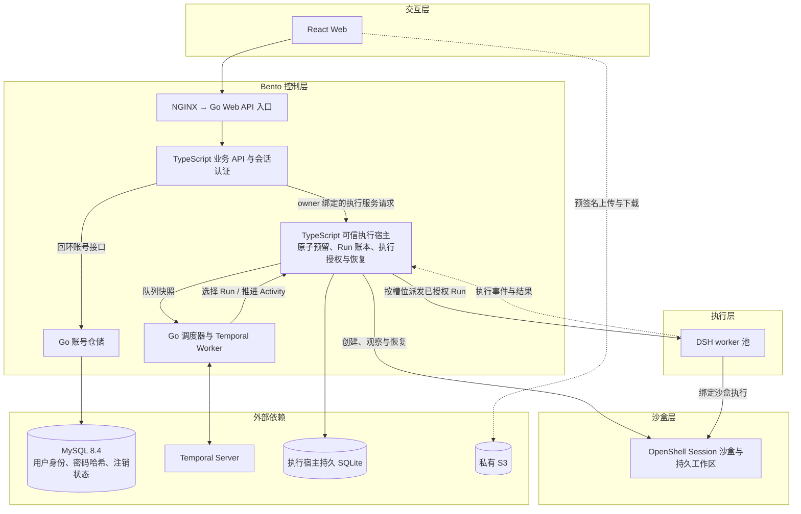

# 架构与职责边界

研究基线冻结于 2026-11-06，Go 控制面与 MySQL 接入更新于 2026-11-11。本文维护架构决策；能力状态见[capabilities](capabilities.md)，交付门槛见[implementation](implementation.md)。

## 架构决策

- 一个顶层业务 Session 对应一个沙盒，跨多个 Run 存续；内部子 Agent Session 不自动创建独立业务沙盒。
- worker 为共享执行池，领取 Run 后动态绑定 Session、执行授权与沙盒。用户注册不固定占用一个 DSH 进程；同进程多 Session 的可行性已验证，生产并发和池化复用仍须验收。
- Workspace 持有持久 Volume，多个 Session 可以共享该 Volume。沙盒是执行生命周期，Volume 是数据生命周期；删除沙盒不得默认删除项目卷。
- 同 Session 默认一个活跃写 Run；共享 Workspace 不默认全局独占。共同编辑必须定义版本守卫、冲突和锁策略。
- 可信 DSH harness 在沙盒外，用户代码在沙盒内。业务服务端决定 tenant/workspace/session/run/generation/sandbox/volume 绑定，worker 和模型不能任意选择目标。
- Session 日志所有权与沙盒执行权分别撤销，只有 generation/owner 一致、旧执行完成停止/对账、绑定及挂载确认后才能 READY。UNKNOWN 先观察/对账，不能因未收到结果就重放副作用。
- 优先复用固定 npm OpenShell 插件、官方 checkpoint/SessionPersistence、OpenShell 原生生命周期及认证、外部持久卷。平台层补业务授权、绑定、调度和恢复协议；当前没有必须修改 DSH 核心的实验证据。
- Run 编排已接入 Temporal [单执行宿主模式](../deployments/HOW-TO-TEMPORAL-DEV.md#接入-bento)。Temporal 持有调度历史，Bento 在 SQLite 持久化 Run 状态、Session、Workspace 绑定和执行授权。Activity 重投以持久 Run 状态决定派发或恢复。账号身份、密码哈希与注销清理状态使用 MySQL；执行宿主的 Run、Session、Workspace 和授权账本继续使用持久 SQLite。
- [Web 部署](../deployments/HOW-TO-WEB-DOCKER.md)由 NGINX 同域提供静态前端并代理 Go Web API 入口。Go 提供 MySQL 账号仓储，现有 TypeScript task-entry 处理业务 API 与会话认证；浏览器直传 S3。
- 启用 Temporal 时，Go 控制面负责租户公平派发策略与 Temporal Client/Worker。TypeScript 执行宿主通过私有标准输入输出协议提供队列快照、原子预留和推进 Run 的能力，继续持有 generation fencing、OpenShell 绑定和恢复账本。Go 选出的 Run 必须经过宿主的容量和状态条件写入后才能发布 Workflow。

## 分层架构

下图描述当前接线。控制层分为 Web 入口部署与执行宿主部署，个人端 Go API 入口与 Orchestrator 的 Temporal 模块各自构建。当前 TS 执行服务持有 Run 账本和执行授权。目标由单一 Go Orchestrator 接管，见 [Bento 工程结构](../30-designs/ENGINEERING-STRUCTURE-DESIGN.md)。

Go 调度进程经 stdio 与单个执行宿主绑定。控制帧只传 Run ID、账号范围内的排队标识和槽位状态。Temporal Workflow 仅接收 Run ID。Go 子进程退出时宿主停止新增 Temporal 派发，重启后按持久状态恢复。Activity 重投继续走同一 Run 的授权与恢复校验。

MySQL 的 `web_accounts` 以稳定 `owner_id` 为主键，账号名唯一。邀请文件用于首次导入账号，已存在账号的身份、凭据与注销状态以 MySQL 为准。注销用单条条件 UPDATE 原子地写入关闭状态、移除密码哈希并登记清理请求。登录会话保存在单个 task-entry 进程内，重启后需重新登录。

Keycloak 部署由独立身份服务管理邀请、注册、凭据、会话及认证审计。Bento 从已验证的 OIDC issuer 和 subject 得到 MySQL 中稳定的 `owner_id`。Keycloak 组织声明用于 Bento 准入，项目与 Run 的归属和业务注销仍由 Bento 管理。

当前 Keycloak 账号绑定与会话设计见 [用户身份与账号数据库设计](../30-designs/USER-DATABASE-DESIGN.md)。

## 三层职责与交接

| 层        | 已验证支撑                                                                                                             | 进入实现时必须补充                                                                 | 验收                                  |
| --------- | ---------------------------------------------------------------------------------------------------------------------- | ---------------------------------------------------------------------------------- | ------------------------------------- |
| 任务会话  | SessionPersistence/provider/checkpoint；旧代 append/flush/close 拒绝；跨主机历史恢复、批次回执、提交未知与事务故障对账 | 业务 Session/Run/审批生命周期、生产持久化与动态身份、外部工具幂等/查询契约         | A1/A2/A5；EXP-023～025                |
| workers   | 单宿主 Temporal 调度；多 Session 路由；子 Agent 继承；双主机接管；有限 OS 凭据隔离和失权 checkpoint                    | 长期池复用/排空、租户公平性/配额、可信控制器多副本协调                             | A3/A6/A8；EXP-019/020/022             |
| OpenShell | 单节点共享 Volume/删除重挂；SSH/PTC 分离、撤 key+断旧连接+stop；固定插件；mTLS 后端与服务端 SDK/raw 准入               | 真实项目导入、目录/卷 ACL、完整 PTY、资源/出口限制、动态能力签发、多节点存储与备份 | A1/A3/A4/A7；EXP-015～018/020/021/025 |

双 worker 主机不等于双执行宿主；部分 AgentLoop 用固定模型适配器；confinement=partial。原始 Gateway 旁路已在受测 worker 权限边界封住，不能继续标成完全未验，也不能据此宣称全入口或恶意宿主隔离已完成。

## 三组交接不变量

| 边界                    | 必须持久化的事实                                                        | 失败场景与通过条件                                                                                                                               |
| ----------------------- | ----------------------------------------------------------------------- | ------------------------------------------------------------------------------------------------------------------------------------------------ |
| 会话 ↔ worker           | Session/Run、owner/generation、事件序号、待对账批次与回执               | A 暂停/崩溃、B 接管后 A 恢复；旧代 append/flush/close 拒绝；已提交不重复写，未提交先对账；AgentLoop 失权不再发新副作用                           |
| worker ↔ OpenShell      | 执行 grant、operation 身份、撤权/停止观察、sandbox instance、READY      | 入口/控制器每阶段崩溃、旧连接/重连/子进程、迟到 stop；未完成旧执行停止和 CAS 不放行新代，UNKNOWN 不盲重放。断流与100ms重检不算 detached 停止证明 |
| 会话 ↔ Workspace/Volume | tenant/workspace/session/sandbox/volume mount、导入状态、引用与回收归属 | 创建部分成功、挂错卷、沙盒删除重建、孤儿资源；正确挂载并恢复文件，不静默建空卷，不因删除一个 Session 误删共享卷或撤销其他 Session                |

数据库事务与远端资源变化不构成同一原子事务。intent、observe/reconcile、可信补偿、receipt 与 READY 必须形成可恢复协议；单机阶段强杀、SSH/PTC停止、工具中断恢复和最新SDK入口各有证据，最终实现仍须在同一链做联合故障验收。
